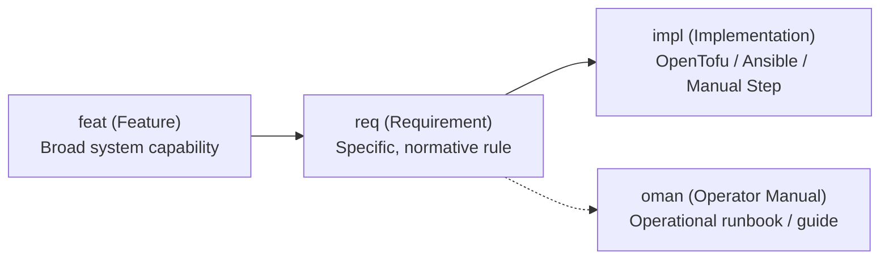

# Requirements & Traceability Conventions

This document explains requirements management, the OpenFastTrace (OFT) toolchain, and the traceability conventions enforced across this repository.

## 1. Requirements & OpenFastTrace (OFT)

Requirements describe the functional capabilities, security boundaries, and operational constraints that the infrastructure must satisfy.

OpenFastTrace (OFT) is an open-source, lightweight requirement tracing suite. It parses plain-text specification items directly within documentation and traces them forward to implementation markers in code and operator instructions in documentation.

We use OFT to ensure:

- **Bidirectional Traceability**: Every architectural goal maps directly to concrete automation tasks, and all infrastructure code fulfills an approved requirement.
- **Regression Detection**: Modifying or removing a requirement revision immediately breaks downstream links, alerting maintainers during CI checks.
- **Defect-Free Infrastructure**: Automated CI pipelines verify that all requirements are fully implemented without orphan tags or missing coverage.

## 2. Traceability Chain: `feat -> req -> impl/oman`

Traceability follows a three-tier hierarchical dependency chain:



### Feature (`feat`)

Broad, high-level objectives describing what the platform provides. Features define the strategic intent of the infrastructure.

- **ID Syntax**: `feat~<name>~<revision>` (e.g. `feat~infrastructure-security~1`)
- **Coverage**: Features must specify `Needs: req`.

### Requirement (`req`)

Concrete, direct, and normative specifications that refine a parent feature into testable or verifiable rules.

- **ID Syntax**: `req~<name>~<revision>` (e.g. `req~host-access-ssh-keys-only~1`)
- **Linkage**: Must reference its parent feature using `Covers: feat~...`.
- **Downstream Needs**:
  - `Needs: impl`: Required when the requirement is fulfilled solely by code automation or a manual runbook step.
  - `Needs: impl, oman`: Required when the requirement is backed by automation code and also described in an operator runbook or operational guide.

### Implementation Marker (`impl`)

Indicates where the requirement is realized in the repository:

- **In OpenTofu / HCL**: Placed above the resource or module definition:

  ```hcl
  # [impl->req~firewall-enabled~1]
  resource "proxmox_virtual_environment_cluster_firewall" "cluster_firewall" { ... }
  ```

- **In Ansible Playbooks / Tasks**: Placed above the task or role invocation:

  ```yaml
  # [impl->req~host-access-ssh-keys-only~1]
  - name: Harden SSH daemon (disable password authentication)
  ```

- **In Documentation (Manual Commands & Setup Runbooks)**: Placed above the manual command when the requirement specifies a manual setup step or documentation artifact:

  ```markdown
  <!-- [impl->req~proxmox-api-permissions-minimal~1] -->
  sudo pveum user add terraform-prov@pve ...
  ```

### Operator Manual Marker (`oman`)

Indicates where the operational procedure, verification runbook, or operator workflow is documented. An `oman` tag exists strictly alongside an `impl` tag:

```markdown
<!-- [oman->req~host-access-ssh-keys-only~1] -->
On the Proxmox host, enforce public key authentication...
```

## 3. Repository Conventions

### Self-Describing Titles & Minimal Body Text

- Item headings must carry the full normative constraint (e.g., `### Access to host should be only via ssh keys`).
- Redundant narrative body text beneath headings is strictly omitted. Proceed directly from the identifier to `Covers:` and `Needs:`.
- Use body text only when specific non-obvious details must be recorded (e.g., listing target applications).

### Storage Location

- All `feat` and `req` specification items are maintained centrally in [docs/requirements.md](../requirements.md).
- Automated CI workflows verify requirements across GitHub Actions, Gitea Workflows, and GitLab CI.
