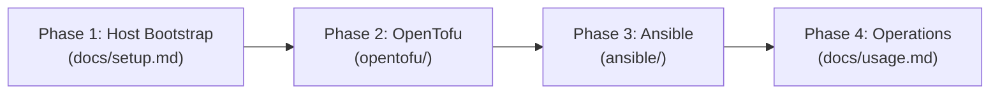

# Infrastructure Architecture & Core Ideas

This document explains the foundational principles, implementation model, and workload organization of the server infrastructure.

## Core Principles

The infrastructure is architected around five core principles:

1. **Infrastructure as Code (IaC)**:
   Every server setting, network bridge, firewall rule, storage allocation, and virtual machine is defined declaratively in version control. No manual resource creation is performed via the Proxmox web interface.

2. **Minimal Manual Handling & Maximum Automation**:
   Manual operator tasks are strictly confined to initial operating system bootstrap commands. Once the server host is prepped, all subsequent provisioning (OpenTofu) and configuration (Ansible) run automatically and idempotently.

3. **Modern & Secure Practices**:
   - Host administrative ports (SSH 22, Proxmox GUI 8006) are isolated from the public internet and restricted to an encrypted Tailscale mesh network.
   - Database networks have zero internet egress (SNAT disabled).
   - SSH password authentication is disabled; authentication is enforced with modern Ed25519 keypairs.
   - Service credentials are generated automatically on the host with strong entropy and stored under restricted permissions.

4. **Single Server with a Single Public IP**:
   The entire infrastructure operates within the physical boundary of one Proxmox VE server possessing exactly one public IPv4 address. Public traffic is routed through a centralized Layer 7 reverse proxy (Caddy) using domain-based SNI routing, while non-HTTP protocols (DNS UDP/TCP 53, Git SSH 2222) are streamed via host-level socket proxying.

5. **Comprehensive Documentation**:
   Every architectural decision, convention, and operational procedure is documented close to code, providing clear technical guidelines, decision records (ADRs), and runbooks for operators and automated agents.

## Implementation Workflow

The infrastructure lifecycle is divided into three distinct phases:

1. **Host Bootstrap ([docs/setup.md](setup.md))**:
   A concise, one-time manual stage executed on a freshly installed Proxmox VE host. It configures basic security, connects Tailscale, installs runtime packages (OpenTofu, Ansible, Git), and establishes the `/srv/admin` workspace.

2. **Infrastructure Provisioning (OpenTofu)**:
   OpenTofu manages the hypervisor layer in `opentofu/`:
   - Software-Defined Networking (SDN) zone, VNets, and subnets.
   - Proxmox resource pools for permission and lifecycle boundaries.
   - Debian cloud image download and Cloud-Init initialization.
   - Virtual machines, virtual firewall rules, and daily backup schedules.

3. **Service Configuration (Ansible)**:
   Ansible manages guest configuration and software state in `ansible/`:
   - System baseline packages, time synchronization, and user account provisioning (`ansible`, `admin`).
   - Docker container runtimes across all VM nodes.
   - Database schemas, roles, and automated credential rotation.
   - Authoritative DNS records, monitoring endpoints, Git repositories, and reverse proxy routes.

## Workload Subdivision: Environment & Type

<!-- [oman->req~environments-core-dev-prod~1] -->

Virtual machines and network segments are organized along two orthogonal axes: **Environment** and **Type**.

Each unique combination of Environment and Type is mapped to a dedicated Software-Defined Network (**VNet**) and an isolated Proxmox **Resource Pool**.

### 1. Environment Axis

- **`core`**: Foundational management, routing, DNS, Git, and shared operational services required by the server itself.
- **`dev`**: Development environments, testing workloads, preview deployments, and non-production instances.
- **`prod`**: Production environments, stable public-facing workloads, customer services, and persistent systems.

### 2. Type Axis

- **`coordinator` (`coord`)**: Ingress reverse proxies, edge routing, coordination hubs, and code repositories (restricted to the `core` environment).
- **`app`**: Compute workloads, stateless services, microservices, and application containers.
- **`data`**: Stateful persistence tiers, relational databases (PostgreSQL), and key-value datastores.

### Environment & Type Matrix

| Environment | Type | VNet ID | VNet Canonical Alias | Subnet CIDR | Resource Pool | Example Services / Workloads |
| :--- | :--- | :--- | :--- | :--- | :--- | :--- |
| **`core`** | **`coord`** | `vcoord` | `vnet-core-coord` | `10.10.1.0/24` | `core-coord` | Caddy reverse proxy, Uptime Kuma monitoring, Gitea Git platform |
| **`core`** | **`app`** | `vcore` | `vnet-core-app` | `10.11.0.0/16` | `core-app` | Technitium DNS authoritative server |
| **`core`** | **`data`** | `vcdb` | `vnet-core-data` | `10.10.2.0/24` | `core-data` | Core PostgreSQL cluster (backs Gitea, internal tools) |
| **`dev`** | **`app`** | `vdev` | `vnet-dev-app` | `10.21.0.0/16` | `dev-app` | Development APIs, web apps, staging containers |
| **`dev`** | **`data`** | `vddb` | `vnet-dev-data` | `10.20.2.0/24` | `dev-data` | Development PostgreSQL database instance |
| **`prod`** | **`app`** | `vprod` | `vnet-prod-app` | `10.32.0.0/16` | `prod-app` | Production APIs, frontends, client workloads |
| **`prod`** | **`data`** | `vpdb` | `vnet-prod-data` | `10.30.2.0/24` | `prod-data` | Production PostgreSQL database instance |

### Isolation & Access Rules

Strict network tiering is enforced between combinations:

- **Egress to Public Internet**: Application and coordinator tiers (`vcoord`, `vcore`, `vdev`, `vprod`) have outbound SNAT enabled. Data tiers (`vcdb`, `vddb`, `vpdb`) have SNAT disabled and cannot initiate outbound internet connections.
- **Cross-Environment Separation**: `dev` and `prod` networks cannot communicate directly with each other. Coordination across tiers is mediated exclusively through `core-coord` services.
- **Storage Tier Isolation**: Workloads in `dev-app` can only reach `dev-data`, and workloads in `prod-app` can only reach `prod-data`.

## Next Steps

- Proceed to [Server Setup Guide](setup.md) to bootstrap a new host.
- Review [Usage & Operations Guide](usage.md) for daily Ansible management commands.
- Consult [Conventions](conventions/README.md) for naming, networking, and permissions standards.
