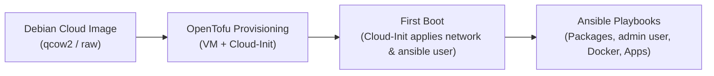

# Virtual Machine Setup Guide

This document describes the automated provisioning workflow, base operating system, and user configuration standards for all Virtual Machines (VMs) in the Proxmox VE environment.

## 1. Automated Provisioning Principle

> [!IMPORTANT]
> **Crucial Rule**: VM provisioning and configuration must **always be performed automatically**.
> Manual creation of VMs through the Proxmox Web GUI or interactive operating system installation wizards is strictly prohibited. All infrastructure must be defined declaratively in OpenTofu (`opentofu/`) and configured via Ansible playbooks to ensure full reproducibility, idempotency, and version control.

## 2. Base Operating System

All virtual machines use Debian Cloud Images. Rationale and architectural trade-offs are documented in [ADR-0004: Choose Debian Cloud Image for Virtual Machines](../decisions/0004-choose-debian-cloud-image-for-virtual-machines.md).

## 3. Standard User Accounts & SSH Access

<!-- [oman->req~vm-access-ssh-keys-only~1] -->

Every provisioned VM is configured with two standard user accounts:

- **`ansible`**: Dedicated service account for automated configuration management and orchestration via Ansible (provisioned during Cloud-Init bootstrap, passwordless sudo, key-based authentication with `secrets/id_ansible.pub`).
- **`admin`**: Interactive administrator account for manual inspection, debugging, and break-glass maintenance (provisioned during Ansible baseline configuration, passwordless sudo, key-based authentication with `secrets/id_admin.pub`).

SSH password authentication is strictly disabled across all VMs (`PasswordAuthentication no`, `KbdInteractiveAuthentication no`) via `/etc/ssh/sshd_config.d/01-hardening.conf` deployed by the `common` Ansible role. Access is permitted exclusively through cryptographic SSH keypairs.

## 4. End-to-End Automated Lifecycle

The VM lifecycle flows through three automated stages:

1. **Base Image Ingestion**: The official Debian Cloud QCOW2 image is downloaded or registered as a Proxmox cloud-init template.
2. **OpenTofu Resource Creation**: OpenTofu (`opentofu/`) allocates the VMID, assigns the VNET / IP address according to [Networking Architecture](../conventions/networking.md), attaches the Cloud-Init drive, and injects the `ansible` user definition with automation public keys.
3. **Cloud-Init Initialization**: On first boot, Cloud-Init configures the hostname, sets static IP addressing, provisions the `ansible` user account, and authorizes SSH access.
4. **Ansible Configuration**: Ansible connects via `secrets/id_ansible`, configures baseline packages, provisions the interactive `admin` account with `secrets/id_admin.pub` and sudo access, deploys Docker, and configures application services.
