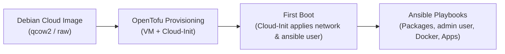

# Virtual Machine Setup Guide

This document describes the automated provisioning workflow, base operating system, and user configuration standards for all Virtual Machines (VMs) in the Proxmox VE environment.

## 1. Automated Provisioning Principle

> [!IMPORTANT]
> **Crucial Rule**: VM provisioning and configuration must **always be performed automatically**.
> Manual creation of VMs through the Proxmox Web GUI or interactive operating system installation wizards is strictly prohibited. All infrastructure must be defined declaratively in OpenTofu (`opentofu/`) and configured via Ansible playbooks to ensure full reproducibility, idempotency, and version control.

## 2. Base Operating System

All virtual machines use Debian Cloud Images. Rationale and architectural trade-offs are documented in [ADR-0004: Choose Debian Cloud Image for Virtual Machines](../decisions/0004-choose-debian-cloud-image-for-virtual-machines.md).

## 3. Standard User Accounts & SSH Access

<!-- [oman->req~vm-access-ssh-keys-only~1] -->

Every provisioned VM is configured with two standard user accounts:

- **`ansible`**: Dedicated service account for automated configuration management and orchestration via Ansible (provisioned during Cloud-Init bootstrap, passwordless sudo, key-based authentication with `secrets/id_ansible.pub`).
- **`admin`**: Interactive administrator account for manual inspection, debugging, and break-glass maintenance (provisioned during Ansible baseline configuration, passwordless sudo, key-based authentication with `secrets/id_admin.pub`).

SSH password authentication is strictly disabled across all VMs (`PasswordAuthentication no`, `KbdInteractiveAuthentication no`) via `/etc/ssh/sshd_config.d/01-hardening.conf` deployed by the `common` Ansible role. Access is permitted exclusively through cryptographic SSH keypairs.

## 4. End-to-End Automated Lifecycle

The VM lifecycle flows through three automated stages:



1. **Base Image Ingestion**: The official Debian Cloud QCOW2 image is downloaded or registered as a Proxmox cloud-init template.
2. **OpenTofu Resource Creation**: OpenTofu (`opentofu/`) allocates the VMID, assigns the VNET / IP address according to [Networking Architecture](../conventions/networking.md), attaches the Cloud-Init drive, and injects the `ansible` user definition with automation public keys.
3. **Cloud-Init Initialization**: On first boot, Cloud-Init configures the hostname, sets static IP addressing, provisions the `ansible` user account, and authorizes SSH access.
4. **Ansible Configuration**: Ansible connects via `secrets/id_ansible`, configures baseline packages, provisions the interactive `admin` account with `secrets/id_admin.pub` and sudo access, deploys Docker, and configures application services.

## 5. VM Provisioning & Configuration Workflow

When creating a new virtual machine workload, the entire lifecycle is automated across six distinct phases:

```mermaid
flowchart TD
    subgraph AdminActions["1. Administrator Workstation & Host Login"]
        DevCode["Edit OpenTofu (opentofu/vms/)<br/>Edit Ansible (inventory/, group_vars/, roles/)"] --> GitPush["Git commit & push to repository"]
        GitPush --> HostLogin["SSH to Proxmox Host via Tailscale<br/>cd /srv/admin && git pull origin main"]
    end

    subgraph TofuPhase["2. OpenTofu Provisioning Phase"]
        HostLogin --> TofuRun["Run 'tofu plan' & 'tofu apply'"]
        TofuRun --> PVEProvision["Proxmox VE API Execution:<br/>• Allocate VMID (1000–3999) & Pool<br/>• Clone Debian GenericCloud Image<br/>• Attach vNIC to SDN VNet (vcoord/vcore/vcdb/vddb/vpdb)<br/>• Configure Cloud-Init (IP, Gateway, 'ansible' user + SSH key)<br/>• Configure VM & Datacenter Firewall Rules<br/>• Create Daily Snapshot Backup Job<br/>• Start Virtual Machine"]
    end

    subgraph CloudInitPhase["3. Cloud-Init First Boot"]
        PVEProvision --> CIBoot["VM First Boot:<br/>• Apply hostname & static IP addressing<br/>• Create 'ansible' service account with sudo privileges<br/>• Inject 'secrets/id_ansible.pub'<br/>• Start sshd & qemu-guest-agent"]
    end

    subgraph AnsiblePhase["4. Ansible Configuration & Service Orchestration"]
        CIBoot --> AnsibleRun["Run 'ansible-playbook -i inventory/hosts.ini site.yml'"]
        AnsibleRun --> AnsibleConnect["Ansible connects to VM via SDN IP<br/>(SSH as 'ansible' using secrets/id_ansible)"]
    end

    subgraph InsideVM["5. What Ansible Executes Inside the VM"]
        direction TB
        AnsibleConnect --> CommonRole["Role: common (Base OS Hardening)<br/>• Update apt cache & install packages (curl, htop, qemu-guest-agent)<br/>• Configure Chrony time synchronization<br/>• Provision interactive 'admin' user with secrets/id_admin.pub & sudo<br/>• Enforce SSH hardening (disable passwords, disable root login)<br/>• Enable unattended-upgrades for automatic security patching"]
        CommonRole --> DockerRole["Role: docker (Container Engine)<br/>• Configure official Docker apt repository & GPG key<br/>• Install Docker CE, containerd, and docker-compose-plugin<br/>• Start docker.service & add users to 'docker' group"]
        DockerRole --> ServiceRole["Role: <service> (Application Deployment)<br/>• Create runtime directory (/srv/<service>)<br/>• Template docker-compose.yml and .env with secrets from /srv/secrets/<br/>• Launch container workloads (docker compose up -d)<br/>• Run healthcheck validation & schema/bucket initialization"]
    end

    subgraph HostRouting["6. Ingress & Edge Integration"]
        ServiceRole --> EdgeRouting["Host / Coordinator Integration:<br/>• If HTTP: Add route to Caddy reverse proxy (auto-provision TLS)<br/>• If Non-HTTP: Add systemd socket proxy on host (DNS 53, Git SSH 2222)<br/>• Register healthcheck monitor in Uptime Kuma"]
    end
```



### Detailed Execution Sequence

The sequence diagram below traces the end-to-end interactions between the operator, the Proxmox control plane, OpenTofu, Cloud-Init, and Ansible tasks executed inside the virtual machine:

```mermaid
sequenceDiagram
    autonumber
    actor Admin as Administrator
    participant Workstation as Local Workstation
    participant Git as Git Repository
    participant Host as Proxmox Host (/srv/admin)
    participant Tofu as OpenTofu
    participant PVE as Proxmox VE API / SDN
    participant VM as New VM (Guest OS)
    participant Ansible as Ansible Orchestrator

    %% Phase 1: Code Authoring
    rect rgb(240, 245, 255)
    Note over Admin,Git: Phase 1: Code Authoring & Git Sync
    Admin->>Workstation: Declare VM (opentofu/vms/<name>.tf)<br/>Declare inventory (ansible/inventory/hosts.ini)<br/>Configure roles & ingress (caddy_sites)
    Workstation->>Workstation: Run pre-commit checks & oft trace
    Workstation->>Git: git push origin main
    end

    %% Phase 2: Host Pull & OpenTofu Provisioning
    rect rgb(245, 255, 245)
    Note over Admin,PVE: Phase 2: Host Execution & OpenTofu Provisioning
    Admin->>Host: SSH via Tailscale (cd /srv/admin)
    Admin->>Host: git pull origin main
    Admin->>Tofu: tofu plan && tofu apply
    Tofu->>PVE: Call Proxmox API (bpg/proxmox provider)
    PVE->>PVE: Allocate VMID (1000–3999), Cores, RAM, Disk
    PVE->>PVE: Attach vNIC to SDN VNet bridge (vcoord/vcore/vcdb/vddb/vpdb)
    PVE->>PVE: Configure Cloud-Init (IP, Gateway, inject ansible user + id_ansible.pub)
    PVE->>PVE: Create daily snapshot backup job
    PVE->>PVE: Start VM
    end

    %% Phase 3: Cloud-Init First Boot
    rect rgb(255, 250, 240)
    Note over PVE,VM: Phase 3: Cloud-Init First Boot
    PVE->>VM: Power on VM from Debian Cloud Image
    VM->>VM: Cloud-Init applies hostname & static IP
    VM->>VM: Cloud-Init creates 'ansible' user (sudoers, id_ansible.pub)
    VM->>VM: Start sshd & qemu-guest-agent
    end

    %% Phase 4: Ansible Configuration
    rect rgb(255, 245, 255)
    Note over Admin,VM: Phase 4: Ansible Orchestration & In-VM Configuration
    Admin->>Ansible: ansible-playbook -i inventory/hosts.ini site.yml
    Ansible->>Host: Verify/generate secrets in /srv/secrets/
    Ansible->>VM: Connect over internal SDN IP (SSH as 'ansible' with id_ansible)

    Note over Ansible,VM: Step 4.1: Common Role (OS Hardening & Base State)
    Ansible->>VM: Update apt cache, install curl, htop, qemu-guest-agent
    Ansible->>VM: Configure Chrony time synchronization
    Ansible->>VM: Provision 'admin' user with id_admin.pub & passwordless sudo
    Ansible->>VM: Enforce SSH hardening (disable passwords, disable root login)
    Ansible->>VM: Configure unattended-upgrades (automated security patching)

    Note over Ansible,VM: Step 4.2: Docker Role (Container Runtime)
    Ansible->>VM: Add Docker official apt repo & install Docker Engine + Compose
    Ansible->>VM: Enable & start docker.service; add users to 'docker' group

    Note over Ansible,VM: Step 4.3: Service Role (Workload Deployment)
    Ansible->>VM: Create service directories (/srv/<service>)
    Ansible->>VM: Template .env and docker-compose.yml with injected secrets
    Ansible->>VM: Launch containers (docker compose up -d)
    Ansible->>VM: Execute service healthcheck & DB/bucket initialization

    Note over Ansible,Host: Step 4.4: Ingress & Host Integration
    Ansible->>Host: Update Caddy reverse proxy route (auto-provision TLS)
    Ansible->>Host: Configure systemd socket proxy (for external non-HTTP ports)
    Ansible->>Host: Register endpoint in Uptime Kuma monitoring
    end

    Ansible-->>Admin: Playbook Complete: VM active, configured, and hardened!
```
