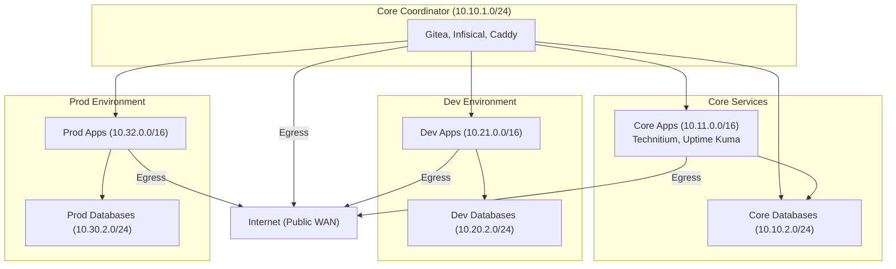

# Networking Architecture

Overview of the network configuration, host firewall rules, network interfaces, and virtual machine / container network topology.

---

## Host Firewall & Port Exposure

The Proxmox VE host firewall enforces a default `DROP` policy on all incoming traffic (`input_policy = "DROP"`) while permitting outgoing traffic (`output_policy = "ACCEPT"`).

Only three specific ports are allowed for host access:

- **UDP 41641 (Tailscale Daemon)**: Accessible to anyone to allow the Tailscale WireGuard engine to negotiate direct peer-to-peer tunnels and communicate with coordination servers.
- **TCP 22 (SSH)**: Allowed **only** to Tailscale users (restricted to the `tailscale0` interface and the `100.64.0.0/10` CGNAT subnet). Connections from the public internet or local LAN are dropped.
- **TCP 8006 (Proxmox Web GUI)**: Allowed **only** to Tailscale users (restricted to the `tailscale0` interface and the `100.64.0.0/10` CGNAT subnet).

---

## Network Interfaces

### `tailscale0`

- Virtual point-to-point network interface created and managed by the Tailscale daemon.
- Handles all authenticated, WireGuard-encrypted mesh network traffic.
- Packets entering this interface are cryptographically validated by Tailscale node keys before reaching host services (SSH and web dashboard).

### `vmbr0`

- Default Linux network bridge created automatically during Proxmox VE installation.
- Attached to the physical network adapter to provide local LAN connectivity, default gateway routing, and outbound internet access for the host.

---

## Virtual Machine & Container Network Architecture (`10.0.0.0/8`)

All virtual machines and LXC containers reside within the private `10.0.0.0/8` address space. This address space is divided into distinct subnetworks categorized by operational tier and environment.

### Subnetwork Segmentation

| Subnetwork Category | Purpose / Example Workloads | Subnet CIDR | Internet Access (SNAT) |
| :--- | :--- | :--- | :--- |
| **Core Coordinator Apps** | Orchestration & routing (Gitea, Infisical, Caddy) | `10.10.1.0/24` | Yes |
| **Core Apps** | Internal core services (Technitium DNS, Uptime Kuma) | `10.11.0.0/16` | Yes |
| **Core Databases** | Dedicated persistence for core services | `10.10.2.0/24` | No |
| **Dev Apps** | Development application workloads | `10.21.0.0/16` | Yes |
| **Dev Databases** | Development persistence layer | `10.20.2.0/24` | No |
| **Prod Apps** | Production application workloads | `10.32.0.0/16` | Yes |
| **Prod Databases** | Production persistence layer | `10.30.2.0/24` | No |

---

## Inter-Subnet Communication & Access Rules

Strict isolation is maintained between environments to implement least-privilege network segmentation:

- **Core Coordinator Apps**: Serve as the central management and routing hub. They are permitted to communicate with:
  - Core Apps
  - Core Databases
  - Dev Apps
  - Prod Apps
- **Core Apps**: Permitted to communicate only with **Core Databases**.
- **Dev Apps**: Permitted to communicate only with **Dev Databases**.
- **Prod Apps**: Permitted to communicate only with **Prod Databases**.
- **Environment Isolation**: Core, Dev, and Prod subnetworks are strictly separated. Workloads in Dev cannot reach Prod or Core workloads (and vice versa), with the sole exception of ingress/coordination mediated by the Core Coordinator apps.
- **Internet Access**:
  - Application tiers (**Core Coordinator**, **Core Apps**, **Dev Apps**, and **Prod Apps**) have outbound internet access for package updates, dependencies, and external APIs.
  - Database tiers (**Core Databases**, **Dev Databases**, and **Prod Databases**) have **no** internet access, as databases do not require external connectivity.

---

## Proxmox SDN & Firewall Implementation

1. **Proxmox Software-Defined Networking (SDN)**:
   - Each subnet is defined as an independent **VNET** within a Proxmox SDN Zone.
   - VNETs isolate Layer 2 broadcast domains across all VM and container workloads.
2. **Firewall Rules**:
   - Traffic crossing VNET boundaries is filtered through the Proxmox VE firewall.
   - Default inter-subnet traffic is blocked, with explicit accept rules matching the communication matrix above.
3. **Internet Access via SNAT**:
   - Outbound internet access is controlled by toggling the **SNAT** (Source NAT) option on each SDN subnet definition.
   - SNAT is enabled for application subnets and disabled for database subnets.

---

## Resource Pools & Permission Boundaries

To align administrative boundaries with governance tiers, workloads are organized into two distinct Proxmox Resource Pools:

- **Host-Managed Resource Pool (`host-managed`)**:
  - Contains all Core services: Core Coordinator, Core Apps, and Core Databases.
  - Managed exclusively by the Proxmox VE host machine using a dedicated Proxmox API token restricted to the `host-managed` resource pool.
- **Git-Managed Resource Pool (`git-managed`)**:
  - Contains all Dev and Prod workloads: Dev Apps, Dev Databases, Prod Apps, and Prod Databases.
  - Managed declaratively through Git-driven CI/CD automation pipelines using scoped credentials.

---

## Machine ID (VMID / CT ID) Allocation

To maintain predictability across provisioning tools and inventories, VM and container IDs follow dedicated numeric ranges:

| Tier / Subnetwork | Machine ID Range (VMID / CT ID) |
| :--- | :--- |
| **Core Coordinators** | `1000` – `1499` |
| **Core Apps** | `1500` – `1899` |
| **Core Databases** | `1900` – `1999` |
| **Dev Apps** | `2000` – `2899` |
| **Dev Databases** | `2900` – `2999` |
| **Prod Apps** | `3000` – `3899` |
| **Prod Databases** | `3900` – `3999` |
