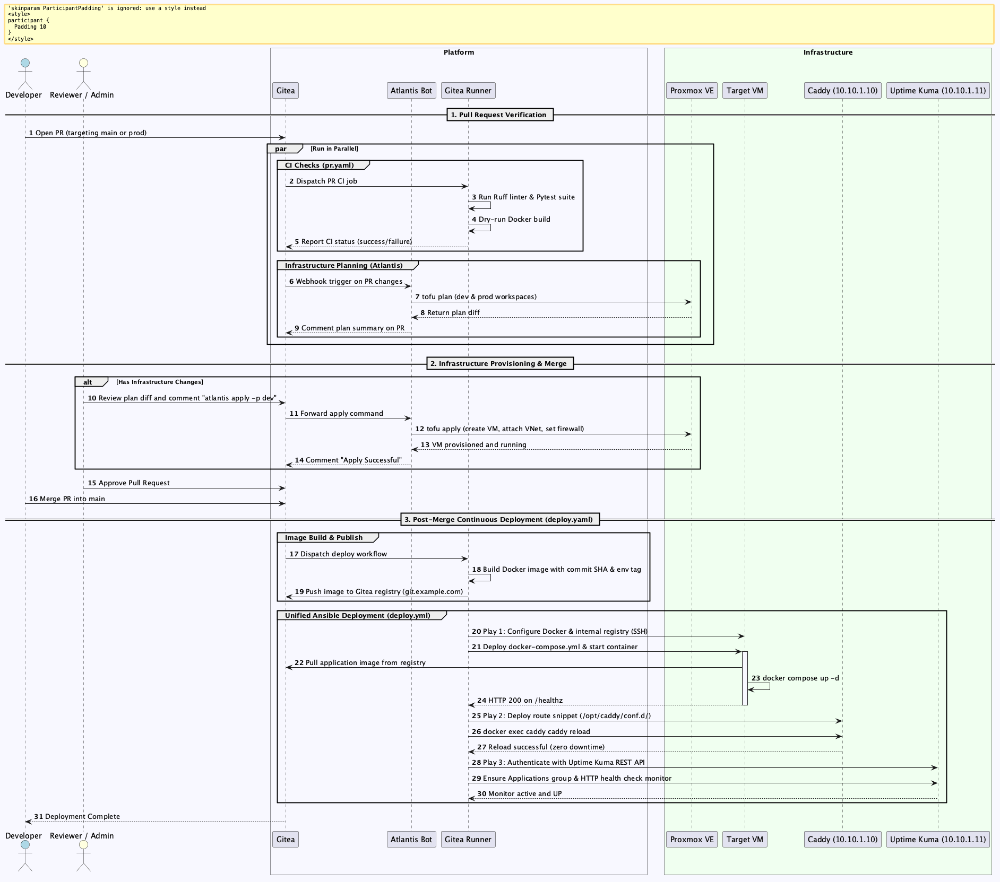

# Pull Request & GitOps Workflow

<!-- [oman->req~gitops-ci-cd-platform~1] -->
<!-- [oman->req~gitops-api-permissions-minimal~1] -->

This document describes the complete GitOps lifecycle for application repositories managed under the Proxmox VE infrastructure stack. It details what occurs when code changes are proposed in a Pull Request, the CI/CD checks executed, the order of operations, and how target virtual machines are provisioned and configured.

## Architecture Overview

Application lifecycle management relies on two complementary automation engines:

1. **Infrastructure GitOps (Atlantis + OpenTofu)**: Automates declarative VM provisioning, hardware sizing, network attachments, and firewall rules directly from Pull Request webhooks on Gitea.
2. **Continuous Integration & Deployment (Gitea Actions + Ansible)**: Executes code quality linting, unit testing, container compilation, image publishing, and unified Ansible post-merge deployment across the target VM, ingress reverse proxy (Caddy), and health monitoring (Gatus).



Diagram source definition is maintained in [pr_workflow.puml](pr_workflow.puml).

## Phase 1: Pull Request Initiation & CI Verification

When a developer opens a Pull Request targeting `main` (for development) or `prod` (for production), Gitea immediately dispatches two parallel pipelines:

### 1. Application CI Checks (`.gitea/workflows/pr.yaml`)

Executed in an isolated container on `core-gitea-runner`:

- **Linting & Code Quality**: Installs `uv` package manager and executes `uv run --extra dev ruff check .` to enforce formatting and style standards.
- **Unit Test Suite**: Runs `uv run --extra dev pytest` against application test cases.
- **Dry-Run Container Build**: Performs `docker build -t <app>:test .` against the Docker daemon on the runner host to validate container recipe integrity without publishing artifacts.

### 2. Atlantis OpenTofu Auto-Planning

Triggered via Gitea webhook to `core-gitea-atlantis`:

- Atlantis inspects `atlantis.yaml` in the repository root and detects active project directories (`opentofu/dev/` and `opentofu/prod/`).
- Runs `tofu plan` for each environment using scoped Proxmox VE API credentials (`atlantis-prov@pve!tofu`).
- Compares declared state with actual Proxmox VE hypervisor state (CPU cores, memory, disk sizes, VNet attachments, and firewall rules).
- Formats the plan output and automatically posts a markdown comment back to the Pull Request.

## Phase 2: Review & Infrastructure Provisioning

1. **Plan Inspection**: The operator reviews the Atlantis plan comment to ensure intended resources match architecture standards:
   - Target VM ID adheres to environment ranges (Core `1000–1999`, Dev `2000–2999`, Prod `3000–3999`).
   - Network interface attaches to designated SDN VNet (`vdev` or `vprod`).
   - Declarative firewall rules restrict ingress to necessary coordinator ports.
2. **Apply Command**: The operator comments on the PR:

   ```text
   atlantis apply -p dev
   ```

3. **Execution on Hypervisor**: Atlantis locks the plan and invokes `tofu apply`. OpenTofu provisions the virtual machine on Proxmox VE:
   - Clones Debian Cloud-Init image (`debian-12-genericcloud-amd64`).
   - Configures CPU, memory, and root disk volume.
   - Sets Cloud-Init network configuration (`ip=10.x.x.x/24,gw=10.x.x.1`).
   - Injects the `ansible-automation` public SSH key into the `ansible` user account.
   - Attaches and enables declarative VM firewall rules.
   - Powers on the VM (`started = true`).
4. **Merge**: Once Atlantis confirms successful application, the Pull Request is approved and merged into `main`.

## Phase 3: Post-Merge Continuous Deployment (`deploy.yaml`)

Merging into `main` automatically fires the deployment workflow on Gitea Actions:

### Job 1: Build & Publish Container (`build-and-push`)

- Inspects target branch to determine environment code (`main` &rarr; `dev`, `prod` &rarr; `prod`).
- Authenticates to the internal Gitea Container Registry (`git.example.com`, or configured `dns_zone_name`) using `REGISTRY_TOKEN`.
- Compiles the application container image using multi-stage Docker build.
- Tags and pushes the image:
  - `git.example.com/<org>/<app>:<env>`
  - `git.example.com/<org>/<app>:latest`

### Job 2: Unified Ansible Deployment (`deploy.yml`)

Once the container image is published, the runner container launches the unified Ansible playbook. The playbook executes three sequential plays across three distinct infrastructure layers:

#### Play 1: Target Workload VM Setup (`dev-app-<name>`)

Target: newly provisioned workload VM (`10.21.0.10` for dev).

- **SSH Connection**: Authenticates as user `ansible` using the private key configured in `VM_DEPLOY_SSH_KEY`.
- **System Package Repositories**:
  - Downloads Docker official GPG key to `/etc/apt/keyrings/docker.asc`.
  - Configures Docker APT repository (`https://download.docker.com/linux/debian`).
  - Installs `docker-ce`, `docker-ce-cli`, `containerd.io`, and `docker-compose-plugin`.
- **Internal Registry Ingress**:
  - Adds `/etc/hosts` mapping pointing `git.example.com` to Caddy coordinator (`10.10.1.10`).
  - Writes `/etc/docker/daemon.json` configuring `insecure-registries: ["git.example.com"]`.
  - Restarts `docker` daemon to apply network configuration.
- **Registry Authentication & Deployment**:
  - Logs in to `git.example.com` via `docker login --password-stdin`.
  - Deploys application `docker-compose.yml` to `/srv/<app>/`.
  - Runs `docker compose up -d --pull always --remove-orphans`.
- **Local Health Validation**:
  - Executes local HTTP probe to `http://127.0.0.1:<port>/healthz` with retry loop until HTTP 200 is confirmed.

#### Play 2: Ingress Reverse Proxy Configuration (`core-coord-caddy`)

Target: Caddy coordinator VM (`10.10.1.10`).

- **Modular Route Snippet**: Writes `/opt/caddy/conf.d/<app>-<env>.Caddyfile` with internal TLS and reverse proxy definition:

  ```caddy
  testapp-dev.example.com {
      tls internal
      reverse_proxy 10.21.0.10:8000
  }
  ```

- **Configuration Hot-Reload**: Executes `docker exec caddy caddy reload --config /etc/caddy/Caddyfile` to activate the route with zero ingress downtime.

#### Play 3: Health Monitoring Configuration (`core-coord-gatus`)

Target: Gatus coordinator VM (`10.10.1.11`).

- **Declarative Endpoint Registration**: Appends or updates the health check endpoint definition in `/opt/gatus/config/config.yaml`:
  - Name: `<app_name> (<ENV>)` (e.g. `Test App (DEV)`)
  - Target URL: `http://<target_vm_ip>:<host_port>/healthz`
  - Group: `Applications`
  - Polling Interval: 60 seconds
  - Condition: `[STATUS] == 200`
- **Configuration Hot-Reload**: Sends SIGHUP or triggers docker compose restart to reload Gatus endpoints without monitoring disruption.

## Order of Operations Summary

| Step | Engine | Target | Description |
| --- | --- | --- | --- |
| 1 | Gitea Actions | Runner container | Code linting (`ruff`), unit tests (`pytest`), Docker build check |
| 2 | Atlantis | Proxmox VE API | Runs `tofu plan` for `dev` and `prod`, posts plan diff to PR |
| 3 | Operator | Gitea PR | Reviews plan, issues `atlantis apply -p dev` comment |
| 4 | Atlantis | Proxmox VE | Creates VM, attaches storage, assigns SDN IP, enables firewall |
| 5 | Operator | Gitea PR | Merges approved PR into `main` |
| 6 | Gitea Actions | Gitea Registry | Builds container, pushes to `git.example.com/<org>/<app>:<tag>` |
| 7 | Ansible (Play 1) | Target VM (`10.21.0.10`) | Installs Docker, sets `/etc/hosts` & daemon config, starts container |
| 8 | Ansible (Play 2) | Caddy (`10.10.1.10`) | Deploys `/opt/caddy/conf.d/` route snippet, hot-reloads Caddy |
| 9 | Ansible (Play 3) | Gatus (`10.10.1.11`) | Registers active HTTP health check monitor in declarative config |

## Related Documentation

- [Infrastructure Architecture & Core Ideas](idea.md): Workload classification and network zone structure.
- [Conventions: Naming](conventions/naming.md): Deterministic VMID and hostname rules.
- [Conventions: Networking](conventions/networking.md): Subnet segmentation and firewall policies.
- [Security: Secrets Management Strategy](security/secrets_management.md): Secret scopes and deployment credential policies.
