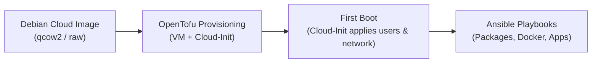

# Virtual Machine Setup Guide

This document describes the automated provisioning workflow, base operating system, and user configuration standards for all Virtual Machines (VMs) in the Proxmox VE environment.

---

## 1. Automated Provisioning Principle

> [!IMPORTANT]
> **Crucial Rule**: VM provisioning and configuration must **always be performed automatically**.
> Manual creation of VMs through the Proxmox Web GUI or interactive operating system installation wizards is strictly prohibited. All infrastructure must be defined declaratively in OpenTofu (`terraform/`) and configured via Ansible playbooks to ensure full reproducibility, idempotency, and version control.

---

## 2. Base Operating System

All virtual machines standardize on the **Debian Cloud Image** (`genericcloud` / `nocloud` build).

For the full architectural trade-off analysis and rationale, see [ADR-0005: Choose Debian Cloud Image for Virtual Machines](decisions/0005-choose-debian-cloud-image-for-virtual-machines.md).

Key benefits of Debian Cloud Images:

- **Ansible-Ready**: Ships with Python 3 pre-installed, enabling Ansible execution on first boot without custom bootstrapping scripts.
- **Minimal Footprint**: Stripped of desktop packages, documentation, and unnecessary daemons, ensuring fast boot times and low resource usage.
- **Native Cloud-Init Support**: Fully compatible with the Proxmox VE cloud-init drive and OpenTofu `bpg/proxmox` provider.
- **Broad Versatility**: Provides full access to Debian package repositories (`apt`), effortlessly supporting both containerized workloads (Docker) and native services.

---

## 3. Standard User Accounts & SSH Access

Every provisioned VM is automatically configured via Cloud-Init with exactly two users:

### `ansible` (Automation User)

- **Purpose**: Dedicated service account for automated configuration management and orchestration via Ansible.
- **Privileges**: Passwordless `sudo` (`ansible ALL=(ALL) NOPASSWD:ALL`).
- **Authentication**: Key-based only. The public key from `secrets/id_ansible.pub` is injected during Cloud-Init provisioning.
- **Private Key**: Kept in `secrets/id_ansible` on the management host (`/srv/admin`) and passed to Ansible via `private_key_file`.

### `admin` (Interactive Administrator User)

- **Purpose**: Account for human administrators for manual inspection, debugging, and break-glass maintenance.
- **Privileges**: Standard `sudo` privileges.
- **Authentication**: Key-based only. The public key from `secrets/id_admin.pub` is injected during Cloud-Init provisioning.
- **Password Authentication**: Disabled across the SSH daemon (`PasswordAuthentication no`).

---

## 4. End-to-End Automated Lifecycle

The VM lifecycle flows through three automated stages:

1. **Base Image Ingestion**: The official Debian Cloud QCOW2 image is downloaded or registered as a Proxmox cloud-init template.
2. **OpenTofu Resource Creation**: OpenTofu (`terraform/`) allocates the VMID, assigns the VNET / IP address according to [Networking Architecture](networking.md), attaches the Cloud-Init drive, and injects user definitions with public keys.
3. **Cloud-Init Initialization**: On first boot, Cloud-Init configures the hostname, sets static IP or DHCP, provisions `ansible` and `admin` user accounts, and authorizes their SSH keys.
4. **Ansible Configuration**: Ansible runs playbooks using `secrets/id_ansible` to install required packages, deploy Docker, and configure services.
