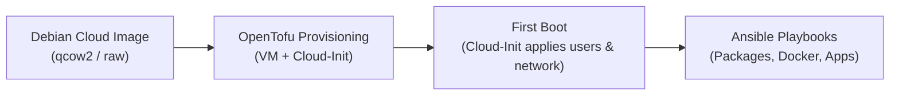

# Virtual Machine Setup Guide

This document describes the automated provisioning workflow, base operating system, and user configuration standards for all Virtual Machines (VMs) in the Proxmox VE environment.

## 1. Automated Provisioning Principle

> [!IMPORTANT]
> **Crucial Rule**: VM provisioning and configuration must **always be performed automatically**.
> Manual creation of VMs through the Proxmox Web GUI or interactive operating system installation wizards is strictly prohibited. All infrastructure must be defined declaratively in OpenTofu (`terraform/`) and configured via Ansible playbooks to ensure full reproducibility, idempotency, and version control.

## 2. Base Operating System

All virtual machines use Debian Cloud Images. Rationale and architectural trade-offs are documented in [ADR-0005: Choose Debian Cloud Image for Virtual Machines](decisions/0005-choose-debian-cloud-image-for-virtual-machines.md).

## 3. Standard User Accounts & SSH Access

Every provisioned VM is automatically configured via Cloud-Init with two user accounts:

- **`ansible`**: Dedicated service account for automated configuration management and orchestration via Ansible (passwordless sudo, key-based authentication with `secrets/id_ansible.pub`).
- **`admin`**: Interactive administrator account for manual inspection, debugging, and break-glass maintenance (sudo privileges, key-based authentication with `secrets/id_admin.pub`).

## 4. End-to-End Automated Lifecycle

The VM lifecycle flows through three automated stages:

1. **Base Image Ingestion**: The official Debian Cloud QCOW2 image is downloaded or registered as a Proxmox cloud-init template.
2. **OpenTofu Resource Creation**: OpenTofu (`terraform/`) allocates the VMID, assigns the VNET / IP address according to [Networking Architecture](networking.md), attaches the Cloud-Init drive, and injects user definitions with public keys.
3. **Cloud-Init Initialization**: On first boot, Cloud-Init configures the hostname, sets static IP or DHCP, provisions `ansible` and `admin` user accounts, and authorizes their SSH keys.
4. **Ansible Configuration**: Ansible runs playbooks using `secrets/id_ansible` to install required packages, deploy Docker, and configure services.
